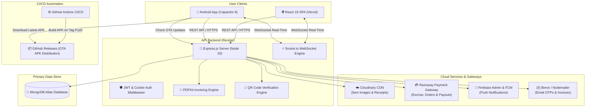
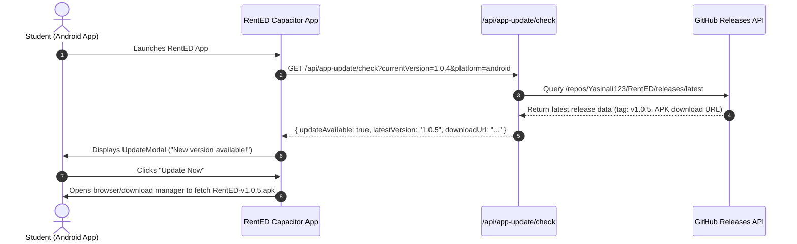

# 🎓 RentED — Student Rental & Resale Hub

[](https://github.com/Yasinali123/RentED/releases)
[](https://nodejs.org/)
[](https://react.dev/)
[](https://vitejs.dev/)
[](https://capacitorjs.com/)
[-3DDC84?logo=android&logoColor=white)](https://developer.android.com/)
[](LICENSE)

> **RentED** is an end-to-end, hyperlocal campus sharing, rental, and second-hand marketplace engineered specifically for college universities. It empowers students to rent, buy, or sell academic essentials—such as textbooks, calculators, engineering drafting kits, lab equipment, cycles, and hostel dorm necessities—with bank-grade escrow payment protection, real-time messaging, campus geofencing, verified student Point-of-Contact (POC) handovers, and native Android mobile apps with automated Over-The-Air (OTA) updates.

---

### 🌐 Live Production Deployments

| Component | Platform | Live URL / Release |
| :--- | :--- | :--- |
| **Web Application** | **Vercel** | [https://rent-ed.vercel.app](https://rent-ed.vercel.app) |
| **API Backend Server** | **Render** | [https://rented-mtrl.onrender.com/api](https://rented-mtrl.onrender.com/api) |
| **Android APK (Direct Download)** | **GitHub Releases** | [RentED Android Releases (v1.0.4)](https://github.com/Yasinali123/RentED/releases) |
| **Source Repository** | **GitHub** | [https://github.com/Yasinali123/RentED](https://github.com/Yasinali123/RentED) |

---

## 📑 Table of Contents

- [Core Value Proposition](#-core-value-proposition)
- [System Architecture](#-system-architecture)
- [Tech Stack Overview](#-tech-stack-overview)
- [Key Features & Capabilities](#-key-features--capabilities)
- [Role-Based Access Control (RBAC)](#-role-based-access-control-rbac)
- [Repository Monorepo Structure](#-repository-monorepo-structure)
- [Environment Variables Reference](#-environment-variables-reference)
- [Local Development Setup](#-local-development-setup)
- [Android App & OTA Updates Pipeline](#-android-app--ota-updates-pipeline)
- [REST API Endpoints Reference](#-rest-api-endpoints-reference)
- [Deployment Guide](#-deployment-guide)
- [Security & Production Hardening](#-security--production-hardening)
- [Contributing & License](#-contributing--license)

---

## 💡 Core Value Proposition

College students spend thousands each semester on textbooks, lab tools, and electronics that remain unused once examinations end. Traditional marketplaces (OLX, Facebook Marketplace) fail on campus because:
1. **High Scam Risk & Distrust**: No escrow or safety guarantees when dealing with strangers.
2. **Geographical Friction**: Sellers and buyers are located on opposite sides of town rather than inside student hostels or campus departments.
3. **Logistical Burden**: Students do not have time to travel across town to pick up a single textbook or calculator.

**RentED solves this with a campus-native ecosystem:**
- **Campus Geofencing**: Students trade exclusively within their college radius or affiliated campuses.
- **Escrow Financial Safety**: Renter payments remain locked in escrow until the item is physically inspected, verified, and returned in good condition.
- **Campus POC (Point of Contact) Logistics**: Student dispatchers coordinate physical pickups and handovers at designated campus spots using scannable QR codes.
- **AI "ASK RENTED" Demand Assistant**: If an item isn't listed yet, students submit what they need; the system automatically matches listings or notifies verified sellers on that campus.

---

## 🏛️ System Architecture



---

## 🛠️ Tech Stack Overview

### Frontend & Mobile Client
- **Framework**: [React 18.3](https://react.dev/) + [Vite 6.0](https://vitejs.dev/) Single Page Application (SPA).
- **Styling**: [Tailwind CSS 3.4](https://tailwindcss.com/) with custom typography, dark/light themes, and responsive layouts.
- **Icons**: [Lucide React](https://lucide.dev/) modern stroke icon library.
- **Maps & Geolocation**: [Leaflet 1.9](https://leafletjs.com/) and [React-Leaflet 4.2](https://react-leaflet.js.org/) for campus proximity radius and boundary mapping.
- **State & Routing**: Context API (`AuthContext`, `ThemeContext`) with [React Router DOM 6.30](https://reactrouter.com/).
- **Networking**: [Axios 1.7](https://axios-http.com/) with interceptors, token refresh rotation, and offline network listeners.
- **Real-Time Client**: [Socket.io Client 4.8](https://socket.io/) for live messaging and typing indicators.
- **Mobile Runtime**: [Capacitor 8.6](https://capacitorjs.com/) with `@capacitor/android`, `@capacitor/app`, `@capacitor/splash-screen`, and `@capacitor/status-bar`.

### Backend & API Services
- **Runtime**: [Node.js](https://nodejs.org/) (>= 18.0.0, ESM module format).
- **Web Framework**: [Express 4.21](https://expressjs.com/) with secure trust proxy configurations.
- **Database & ODM**: [MongoDB Atlas](https://www.mongodb.com/atlas) with [Mongoose 8.9](https://mongoosejs.com/).
- **Real-Time Server**: [Socket.io 4.8](https://socket.io/) bi-directional event stream with CORS isolation.
- **Authentication**: Stateless JSON Web Tokens (`jsonwebtoken`) signed with rotating access and refresh tokens, paired with secure HTTP-only cookies and Bearer header fallback.
- **Security & Headers**: [Helmet 8.3](https://helmetjs.github.io/), [express-rate-limit 8.6](https://github.com/express-rate-limit/express-rate-limit), and strict CORS origin validation.
- **Document & QR Generation**: [PDFKit 0.19](https://pdfkit.org/) for streaming PDF tax invoices, and [QRCode 1.5](https://github.com/soldair/node-qrcode) for handover tokens.

### Third-Party Services
- **Payments & Escrow**: [Razorpay](https://razorpay.com/) (Standard Checkout, Webhooks, Escrow deposit holds, and automatic seller/POC payouts).
- **Media Storage**: [Cloudinary](https://cloudinary.com/) with `multer-storage-cloudinary` for student ID cards, item photos, and handover inspection proof.
- **Transactional Communication**: [Brevo](https://www.brevo.com/) (formerly Sendinblue) & Nodemailer for student email OTP verification and receipts.
- **Push Notifications**: [Firebase Admin SDK](https://firebase.google.com/docs/admin/setup) & Firebase Cloud Messaging (FCM).

---

## ✨ Key Features & Capabilities

### 1. 🛒 Campus Marketplace & Flexible Rental Engine
- **Multi-Duration Pricing**: Sellers define daily, weekly, and monthly rates alongside an upfront refundable security deposit.
- **Direct Sale vs. Rental**: Choose whether to rent an asset for a semester or sell it outright.
- **Condition Grading**: Clear categorization (`Brand New`, `Like New`, `Gently Used`, `Fair`) with detailed wear-and-tear descriptions and multi-angle photos.
- **College Filtering**: Filter listings strictly within your campus, neighboring colleges, or nationwide.

### 2. 🛡️ Three-Way Escrow Financial Architecture
- **Guaranteed Payment Protection**:
  1. The renter pays the rental fee + security deposit via Razorpay or in-app wallet.
  2. Funds are safely held in the RentED Escrow account (`Escrow` collection).
  3. Physical handover is performed and confirmed via scannable QR tokens.
  4. When the rental period ends and the item is returned undamaged, the security deposit is automatically refunded to the renter.
  5. The seller payout and campus POC delivery commission are transferred immediately.
- **Dispute Resolution Mechanism**: In case of damage or late returns, either party can raise a dispute with photo evidence, allowing administrators to arbitrate escrow funds.

### 3. 📍 Campus Proximity & Interactive Maps
- **Geofenced Campus Radius**: Uses `geolib` and `Leaflet` to calculate exact geodesic distances between student dorms and academic departments.
- **Safe Campus Exchange Spots**: Highlights verified campus meetup zones (e.g., University Library, Central Canteen, Main Gate Security Desk).

### 4. 💬 Real-Time Messaging & Presence
- **Socket.io Chat**: Instant peer-to-peer messaging between prospective renters and item owners.
- **Typing Indicators & Read Receipts**: Live feedback on conversation status.
- **Direct Order Integration**: Initiate rental requests or checkout directly from within the chat window.

### 5. 🤖 "ASK RENTED" AI Demand Assistant
- **Context-Aware Floating Assistant**: Displayed cleanly on the Home and Marketplace pages.
- **Demand Capture Engine**: Students who cannot find a specialized book or tool can type their requirements in natural language.
- **Automated Listing Matching**: The engine checks the database for existing matches or records a `WantedItem` alert that notifies sellers matching the requested category on that campus.

### 6. 📱 Campus Point-of-Contact (POC) Logistics & QR Verification
- **Student Dispatchers**: Campus POCs act as trusted local intermediaries who oversee item exchanges and hold items securely between classes.
- **Dual QR Code Handover Protocol**:
  - **Pickup QR**: Generated on renter approval; scanned by POC/seller to transition status to `active`.
  - **Return QR**: Generated upon completion; scanned to verify return condition and trigger escrow release.
- **Automated Delivery Commission**: POCs earn a configurable percentage on every successful handover processed.

### 7. 📄 Instant PDF Invoicing & Audit Trails
- **Automated Invoicing**: Uses `PDFKit` to stream compliant PDF invoices containing transaction IDs, GST/tax breakdowns, escrow details, and return terms.
- **Downloadable Receipts**: Available anytime from the student order history dashboard.

### 8. 📲 Native Android App with In-App OTA Updates
- **Capacitor 8 Integration**: Full native compilation with Android 15/16 (SDK 36) support.
- **Custom Adaptive Icons & Splash Screen**: Official RentED branding with dark status bars and native transitions.
- **Over-The-Air (OTA) Updates**: The mobile app monitors `/api/app-update/check` and the GitHub Releases API. When a new version is tagged, a non-intrusive in-app update banner allows students to download and install updates immediately without needing third-party app stores.

---

## 👥 Role-Based Access Control (RBAC)

RentED features four distinct user roles, each equipped with dedicated dashboard interfaces:

| Capability / Action | Student | Seller | Campus POC | Admin |
| :--- | :---: | :---: | :---: | :---: |
| Browse & Search Marketplace | ✅ | ✅ | ✅ | ✅ |
| Submit Rental / Buy Requests | ✅ | ✅ | ✅ | ✅ |
| Ask Demand Assistant / Post Wanted Items | ✅ | ✅ | ✅ | ✅ |
| List Items for Rent or Sale | ❌ | ✅ | ❌ | ✅ |
| Approve / Decline Rental Bookings | ❌ | ✅ | ❌ | ✅ |
| Request Wallet Balance Withdrawals | ❌ | ✅ | ✅ | ✅ |
| Scan Handover & Return QR Codes | ❌ | ❌ | ✅ | ✅ |
| Manage Campus Pickup Drop-Offs | ❌ | ❌ | ✅ | ✅ |
| Moderate Listings & Ban Bad Actors | ❌ | ❌ | ❌ | ✅ |
| Resolve Escrow Disputes & Issue Refunds | ❌ | ❌ | ❌ | ✅ |
| Configure Platform Commission & Rates | ❌ | ❌ | ❌ | ✅ |

---

## 📂 Repository Monorepo Structure

```text
RentED/
├── .github/
│   └── workflows/
│       └── build-apk.yml           # Automated GitHub Actions APK build & OTA release pipeline
├── client/                         # Frontend React SPA + Capacitor Android Project
│   ├── android/                    # Native Android Studio project (Capacitor 8)
│   │   ├── app/
│   │   │   ├── build.gradle        # App Gradle config (SDK 36, Java 21, versionCode/Name)
│   │   │   └── src/main/
│   │   │       ├── AndroidManifest.xml
│   │   │       └── res/            # Adaptive icons (mipmap), splash screen, colors
│   │   └── build.gradle            # Root Android Gradle build script (AGP 8.13.0)
│   ├── public/                     # Static web assets, favicon, logos
│   ├── src/
│   │   ├── api/                    # Axios client, auth interceptors, API endpoints
│   │   ├── components/
│   │   │   ├── chat/               # ChatWindow, ConversationList, DemandAssistantChat
│   │   │   ├── dashboard/          # Student, Seller, POC, Admin dashboard views
│   │   │   ├── items/              # ItemCard, ItemGrid, FilterSidebar, SearchBar
│   │   │   ├── layout/             # AppShell, Navbar, Footer, ProtectedRoute
│   │   │   ├── maps/               # Leaflet LocationPicker, MapView, NearbyMap
│   │   │   └── ui/                 # UpdateModal, SmokyWaveCanvas, Autocomplete
│   │   ├── context/                # AuthContext (JWT/user state), ThemeContext
│   │   ├── hooks/                  # useMobileApp, useSocket, useGeolocation
│   │   ├── pages/                  # HomePage, MarketplacePage, CheckoutPage, SellRentPage...
│   │   ├── services/               # updateService.js (OTA version detection)
│   │   ├── App.jsx                 # Route definitions and application shell
│   │   ├── index.css               # Tailwind directives and custom scrollbar styling
│   │   └── main.jsx                # React DOM mount point
│   ├── capacitor.config.json       # Capacitor configuration (app ID, allowNavigation, splash)
│   ├── package.json                # Client dependencies and Vite scripts
│   ├── tailwind.config.js          # Tailwind theme colors and design tokens
│   ├── vercel.json                 # Vercel SPA client rewrite routing rules
│   └── vite.config.js              # Vite build setup with React plugin and server proxy
├── server/                         # Backend Express REST API + Socket.io Server
│   ├── src/
│   │   ├── config/                 # DB connection, Cloudinary, Razorpay, Brevo configs
│   │   ├── controllers/            # Auth, items, rentals, payments, chat, POC controllers
│   │   ├── middleware/             # authMiddleware, roleValidator, errorMiddleware, rateLimiter
│   │   ├── models/                 # Mongoose schemas: Item, User, Escrow, RentalRequest, etc.
│   │   ├── routes/                 # Express API routes (auth, items, rentals, payments, chat...)
│   │   ├── seed/                   # Database seeders with realistic colleges, items, users
│   │   ├── services/               # Email service, push notifications, escrow logic, invoices
│   │   ├── socket/                 # Socket.io handlers (chat events, typing, presence)
│   │   ├── utils/                  # Geolocation math, token generators, QR encoders
│   │   ├── app.js                  # Express application setup, CORS policy, route binding
│   │   └── server.js               # HTTP + Socket.io server entry point
│   ├── package.json                # Server dependencies and nodemon runner scripts
│   └── .env.example                # Template for server environment variables
├── build.js                        # Monorepo cross-platform build runner
├── DEPLOYMENT.md                   # Production deployment guide for Vercel & Render
├── package.json                    # Root monorepo workspace scripts
└── README.md                       # Comprehensive project documentation
```

---

## 🔐 Environment Variables Reference

### 1. Server Environment Variables (`server/.env`)

| Variable Name | Required | Default / Example | Purpose |
| :--- | :---: | :--- | :--- |
| `PORT` | Optional | `5000` | Port for the Express server to listen on. |
| `NODE_ENV` | Optional | `development` / `production` | Runtime mode. |
| `MONGODB_URI` | **Required** | `mongodb+srv://...` | MongoDB Atlas database connection URI. |
| `JWT_SECRET` | **Required** | `super-secret-jwt-key` | Cryptographic secret for signing access tokens (15m expiry). |
| `JWT_REFRESH_SECRET` | **Required** | `super-secret-refresh-key` | Cryptographic secret for signing refresh tokens (7d expiry). |
| `CLIENT_URL` | **Required** | `https://rent-ed.vercel.app` | Frontend client URL for strict CORS validation (no trailing slash). |
| `RENDER_EXTERNAL_URL`| Optional | `https://rented-mtrl.onrender.com` | Self backend URL for webhooks and health checks. |
| `CLOUDINARY_CLOUD_NAME`| **Required**| `your_cloud_name` | Cloudinary account cloud name for item and avatar uploads. |
| `CLOUDINARY_API_KEY` | **Required** | `your_api_key` | Cloudinary API access key. |
| `CLOUDINARY_API_SECRET`| **Required**| `your_api_secret` | Cloudinary API access secret. |
| `BREVO_API_KEY` | Optional | `xkeysib-...` | Brevo (Sendinblue) API key for sending email OTPs and invoices. |
| `EMAIL_USER` | Optional | `support@rented.com` | Verified sender email address for outgoing system emails. |
| `SENDER_NAME` | Optional | `RentED Support` | Display name for outgoing system emails. |
| `RAZORPAY_KEY_ID` | **Required** | `rzp_test_...` | Razorpay public key ID for checkout orders. |
| `RAZORPAY_KEY_SECRET` | **Required** | `your_secret` | Razorpay private secret for webhook signature verification. |
| `FIREBASE_SERVICE_ACCOUNT`| Optional | `{ "type": "service_account"... }` | Minified JSON string for Firebase Admin SDK (push notifications). |

### 2. Client Environment Variables (`client/.env`)

| Variable Name | Required | Default / Example | Purpose |
| :--- | :---: | :--- | :--- |
| `VITE_API_URL` | **Required** | `https://rented-mtrl.onrender.com/api` | Base API endpoint for Axios and WebSocket handshakes. |
| `VITE_RAZORPAY_KEY_ID`| **Required** | `rzp_test_...` | Razorpay client key ID for launching the payment modal. |
| `VITE_CLOUDINARY_CLOUD_NAME`| **Required** | `your_cloud_name` | Cloudinary cloud name for direct asset loading and optimization. |
| `VITE_CLOUDINARY_API_KEY`| Optional | `your_api_key` | Cloudinary public key. |
| `VITE_FIREBASE_API_KEY`| Optional | `AIzaSy...` | Firebase Web API key for push notification tokens. |
| `VITE_FIREBASE_PROJECT_ID`| Optional | `rented-ff27d` | Firebase Project ID. |
| `VITE_APP_VERSION` | Optional | `1.0.4` | Current app version displayed in settings and used for OTA checks. |
| `VITE_GITHUB_REPO` | Optional | `Yasinali123/RentED` | Repository slug for checking GitHub Releases for OTA APK updates. |

---

## 🚀 Local Development Setup

Follow these steps to set up and run the entire RentED stack locally on your workstation:

### Prerequisites
- **Node.js**: `v18.0.0` or higher ([Download](https://nodejs.org/))
- **npm**: `v9.0.0` or higher
- **MongoDB**: A running local MongoDB instance or a free [MongoDB Atlas](https://www.mongodb.com/atlas) cluster URI.
- **Git**: Installed and configured.
- *(Optional for Android build)*: [Android Studio](https://developer.android.com/studio) and Java JDK 21.

---

### Step 1: Clone the Repository
```bash
git clone https://github.com/Yasinali123/RentED.git
cd RentED
```

### Step 2: Install Monorepo Dependencies
Install root and sub-project dependencies:
```bash
# Install root orchestration tools
npm install

# Install server dependencies
cd server
npm install

# Install client dependencies
cd ../client
npm install
cd ..
```

### Step 3: Configure Environment Files
1. Create `server/.env` based on `server/.env.example`:
   ```bash
   cp server/.env.example server/.env
   ```
   Fill in your MongoDB URI, JWT secrets, and payment keys.

2. Create `client/.env` based on `client/.env.example`:
   ```bash
   cp client/.env.example client/.env
   ```
   For local development, you can set:
   ```env
   VITE_API_URL=http://localhost:5000/api
   ```

### Step 4: Seed the Database
Populate your MongoDB database with verified partner universities, sample categories, user accounts, and active rental listings:
```bash
npm run seed
```

> **Pre-Seeded Test Credentials:**
> - **Student Account**: `student@university.edu` / `password123`
> - **Seller Account**: `seller@university.edu` / `password123`
> - **POC Account**: `poc@university.edu` / `password123`
> - **Admin Account**: `admin@university.edu` / `adminpassword123`

### Step 5: Start the Development Servers
From the root directory, run both frontend and backend concurrently:
```bash
npm run dev
```

- **Frontend Client**: Accessible at `http://localhost:5173`
- **Backend API**: Accessible at `http://localhost:5000/api`
- **Health Check**: Visit `http://localhost:5000/api/health`

---

## 📱 Android App & OTA Updates Pipeline

RentED features a first-class native Android experience powered by **Capacitor 8**.

### Running Android Locally via Android Studio
```bash
# 1. Build the web distribution bundle
npm run client:build

# 2. Sync web assets and plugins to Android project
npm run android:sync

# 3. Open the native project in Android Studio
npm run android:open
```
Inside Android Studio, select your emulator or connected USB device and press **Run (Shift + F10)**.

---

### Automated CI/CD GitHub Actions Workflow (`build-apk.yml`)

RentED is configured with an automated continuous delivery pipeline located at [`.github/workflows/build-apk.yml`](.github/workflows/build-apk.yml).

Every time a Git tag matching `v*` is pushed or when the workflow is manually triggered from GitHub Actions:
1. **Runner Environment**: Spins up an `ubuntu-latest` container with Node.js 20 and Temurin Java JDK 21.
2. **SDK Configuration**: Pre-installs Android SDK Build-Tools `36.0.0` and API Platform `36` (Android 15/16).
3. **Web Compilation**: Compiles the React 18 SPA with production environment configurations.
4. **Capacitor Sync**: Injects the web build directly into `client/android/app/src/main/assets/public/`.
5. **Gradle Build**: Runs `./gradlew assembleDebug` (and release) with Gradle optimizations.
6. **Artifact Upload**: Uploads standalone APK artifacts (`RentED-v1.0.x-debug.apk` and `RentED-latest.apk`).
7. **GitHub Release Publication**: Automatically drafts a GitHub Release containing changelogs and the compiled APKs for immediate student download.

---

### How In-App Over-The-Air (OTA) Updates Work



#### Releasing a New OTA Update in 2 Commands:
To publish an update to all student devices:
```bash
git tag v1.0.5
git push origin v1.0.5
```
GitHub Actions will automatically build the APK, publish the release, and notify all active devices!

---

## 📡 REST API Endpoints Reference

All API routes are prefixed with `/api`. Protected routes require an `accessToken` cookie or an `Authorization: Bearer <token>` HTTP header.

### 🔑 Authentication (`/api/auth`)
| Method | Endpoint | Access | Description |
| :--- | :--- | :---: | :--- |
| `POST` | `/api/auth/signup` | Public | Register a new user account with student ID and college details. |
| `POST` | `/api/auth/login` | Public | Authenticate user; returns user object and sets secure HTTP-only cookie. |
| `POST` | `/api/auth/logout` | Authenticated | Clears authentication tokens and invalidates session. |
| `GET` | `/api/auth/me` | Authenticated | Fetch currently authenticated user profile and roles. |
| `POST` | `/api/auth/verify-email` | Public | Verify student email address using 6-digit OTP code. |
| `POST` | `/api/auth/resend-otp` | Public | Resend verification OTP code to email. |
| `POST` | `/api/auth/forgot-password`| Public | Request password reset token via email. |
| `POST` | `/api/auth/reset-password` | Public | Reset password using verified token. |

### 📦 Items & Inventory (`/api/items`)
| Method | Endpoint | Access | Description |
| :--- | :--- | :---: | :--- |
| `GET` | `/api/items` | Public | Query listings with filters (category, college, price range, search). |
| `GET` | `/api/items/:id` | Public | Retrieve full item specification, owner profile, and rental rates. |
| `POST` | `/api/items` | Seller / Admin | Create a new rental or sale listing with Cloudinary image upload. |
| `PUT` | `/api/items/:id` | Owner / Admin | Update listing details, prices, or availability status. |
| `DELETE`| `/api/items/:id` | Owner / Admin | Archive or remove an item listing. |

### 🤝 Rentals & Escrow (`/api/rentals`)
| Method | Endpoint | Access | Description |
| :--- | :--- | :---: | :--- |
| `POST` | `/api/rentals` | Student | Submit a rental request with duration, deposit, and delivery preference. |
| `GET` | `/api/rentals/my-rentals` | Authenticated | Fetch active, pending, and past rentals for the student. |
| `PATCH`| `/api/rentals/:id/approve` | Seller | Approve a pending rental booking request. |
| `PATCH`| `/api/rentals/:id/decline` | Seller | Decline a booking and trigger automated deposit refund. |
| `POST` | `/api/rentals/:id/handover`| POC / Seller | Verify handover pickup using dual-token scannable QR verification. |
| `POST` | `/api/rentals/:id/return` | POC / Seller | Confirm return of item, verify condition, and release escrow funds. |

### 💳 Payments & Escrow (`/api/payments`)
| Method | Endpoint | Access | Description |
| :--- | :--- | :---: | :--- |
| `POST` | `/api/payments/create-order` | Authenticated | Create a Razorpay checkout order for rental payment + escrow deposit. |
| `POST` | `/api/payments/verify` | Authenticated | Cryptographically verify Razorpay payment signature and fund escrow. |
| `GET` | `/api/payments/wallet` | Authenticated | View current in-app wallet balance, earnings, and transaction history. |
| `POST` | `/api/payments/withdraw` | Seller / POC | Request wallet payout to verified bank UPI or account. |

### 💬 Real-Time Chat (`/api/chat`)
| Method | Endpoint | Access | Description |
| :--- | :--- | :---: | :--- |
| `GET` | `/api/chat/conversations` | Authenticated | List all active student conversation threads. |
| `GET` | `/api/chat/:conversationId` | Authenticated | Load paginated message history for a conversation. |
| `POST` | `/api/chat/send` | Authenticated | Send a direct message (also emitted live via Socket.io). |

### 💡 Demand Assistant & Wanted Items (`/api/wanted-items`)
| Method | Endpoint | Access | Description |
| :--- | :--- | :---: | :--- |
| `POST` | `/api/wanted-items` | Student | Submit a product demand query via the "ASK RENTED" assistant. |
| `GET` | `/api/wanted-items` | Authenticated | Browse unfilled campus demand requests to list matching inventory. |

### 📲 In-App OTA Update (`/api/app-update`)
| Method | Endpoint | Access | Description |
| :--- | :--- | :---: | :--- |
| `GET` | `/api/app-update/check` | Public | Compares client version against latest GitHub Release and returns update status. |

---

## 🚢 Deployment Guide

### Deploying API Backend to Render
1. Create a new **Web Service** on [Render Dashboard](https://dashboard.render.com/).
2. Connect the `RentED` repository.
3. Configure the build parameters:
   - **Environment**: `Node`
   - **Build Command**: `npm run build` *(or `cd server && npm install`)*
   - **Start Command**: `npm start` *(or `cd server && node src/server.js`)*
4. Add all environment variables listed in the [Server Environment Variables](#1-server-environment-variables-serverenv) table.
5. In Render settings, ensure `trust proxy` is active (already handled via `app.set("trust proxy", 1)`).

### Deploying Web Client to Vercel
1. Import the Git repository into [Vercel](https://vercel.com/).
2. Select the `client` directory as the Root Directory (or build from root with `npm run client:build`).
3. Set the Framework Preset to **Vite**.
4. Add the environment variable:
   - `VITE_API_URL` = `https://rented-mtrl.onrender.com/api`
5. Deploy. Vercel automatically honors `client/vercel.json` rewrites for single-page routing.

---

## 🔒 Security & Production Hardening

- **Stateless Dual-Token Authentication**: Access tokens expire in 15 minutes; refresh tokens are stored in `HttpOnly`, `SameSite=None`, `Secure` cookies to protect against XSS and CSRF attacks.
- **Strict CORS Origin Whitelisting**: The API whitelist dynamically permits local development ports, production Vercel frontends, and Capacitor mobile origins (`capacitor://localhost`, `https://localhost`).
- **Rate Limiting**: Critical authentication endpoints (`/login`, `/signup`, `/verify-otp`, `/forgot-password`) enforce strict rate limits per IP to thwart brute-force attacks.
- **Cryptographic Signature Verification**: Razorpay payment confirmations are verified using HMAC SHA256 signatures before any escrow funds or balances are credited.
- **QR Handover Tokens**: QR codes generated for physical deliveries contain encrypted, single-use, time-bounded tokens that prevent unauthorized handovers.

---

## 🤝 Contributing

Contributions are welcome! Please follow these guidelines:
1. Fork the repository.
2. Create your feature branch: `git checkout -b feat/amazing-feature`.
3. Commit your changes: `git commit -m "feat: add amazing feature"`.
4. Push to your branch: `git push origin feat/amazing-feature`.
5. Open a Pull Request.

---

## 📄 License

Distributed under the **MIT License**. See `LICENSE` for more information.

---

<p align="center">
  <b>Built with ❤️ for college students worldwide by the RentED Team.</b><br/>
  <sub>Empowering sustainable campus sharing, one semester at a time.</sub>
</p>
